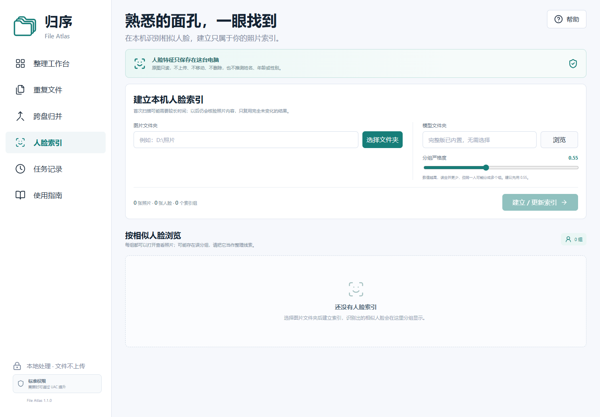

# 归序 · File Atlas

**把散落的文件整理清楚，每一步都先预览。**

归序是一款在本机运行的文件整理工具，将媒体与文档分类、精确内容去重、跨目录归并、图片与视频预览和离线人脸索引放进同一个中文界面。分类和归并默认复制，去重副本进入可恢复隔离区；人脸索引只读原图。



[下载 Windows 版 FileAtlas-Windows.zip](https://github.com/eshyee/file-atlas/releases/latest/download/FileAtlas-Windows.zip) · [全部 Releases](https://github.com/eshyee/file-atlas/releases) · [文件与隐私安全](SECURITY.md) · [原脚本整合说明](docs/legacy-integration.md)

## 主要功能

| 功能 | 适合做什么 | 默认行为 |
| --- | --- | --- |
| 智能分类 | 整理照片、视频、音频和常见文档 | 按类型、日期、设备或文档格式生成目录，预览后复制 |
| 精确去重 | 查找一个或多个目录中的相同内容 | 完整内容校验后保留一份，将选中的冗余副本移入隔离区 |
| 文件归并 | 把多个来源汇入一个目标目录 | 保留来源及相对路径，同名另起文件名 |
| 本机媒体预览 | 在整理清单内查看图片和视频 | 只允许预览本次扫描中的文件，不接受任意路径 |
| 人脸索引 | 将照片中的相似人脸归入同一索引，按组浏览 | 原图只读，特征与索引仅保存在本机，不猜人物身份 |

媒体采用原 v6 的时间优先目录：`picture_classify/2020/2020-01/SONY_ILCE-6700/照片.jpg`。日期比较媒体元数据、文件名日期和文件创建时间，选取最早的有效值。文档采用 `document_classify/PDF/2024-09/报告.pdf` 等目录。JSON、YAML 等结构化配置文件默认不参与分类。

## Windows 下载与使用

1. 从 [Releases](https://github.com/eshyee/file-atlas/releases) 下载 `FileAtlas-Windows.zip` 并解压。
2. 双击 `FileAtlas.exe`，程序会在浏览器打开本机界面。
3. 选择整理方式、来源和目标目录，点击扫描；图片和视频可以在清单中直接预览。
4. 查看文件、目标位置、重复项和跳过原因，再确认执行；也可以打开“人脸索引”按相似面孔浏览照片。

程序运行期间请保留启动窗口；关闭窗口或按 `Ctrl+C` 结束服务。浏览器地址只供本机使用，每次启动的会话凭据不同。

分类和归并默认保留原文件。需要移动时，应在界面中主动选择移动并确认。先用小目录熟悉预览与恢复流程，再处理较大的文件集合。

### 人脸索引

Windows 完整版内置本地 OpenCV 推理运行时，以及经固定 SHA-256 校验的 YuNet 检测模型和 SFace 特征模型；运行时不会下载模型，照片和人脸特征不会发送到网络。源码安装可使用：

```powershell
python -m pip install -e ".[faces,heif]"
```

如果没有使用完整版，可在“人脸索引”中选择包含以下两个文件的本地模型目录：

```text
face_detection_yunet_2023mar.onnx
face_recognition_sface_2021dec.onnx
```

每次更新会先建立完整的新索引，完成后才切换；取消或意外中断不会替换上一版可浏览索引。相同模型和设置下，完全未变化的照片可以复用推理结果；照片仍会重新校验内容哈希。分组编号只是相似人脸候选，不代表现实身份，可能出现误分或漏分。

支持 JPEG、PNG、WebP、BMP 和 TIFF。官方 Windows 包不内置 `pillow-heif`；HEIC/HEIF 人脸索引需使用安装了 `[faces,heif]` 的源码版本。人脸索引暂不解码 RAW，可索引相机同时保存的 JPEG。单张图片默认限制为 48 MP、256 MiB，避免异常图片耗尽内存。

### 图片和视频预览

JPEG、PNG、GIF、WebP、AVIF 与浏览器支持的 MP4、WebM、Ogg 可直接预览。HEIC、TIFF、RAW 和其他常见视频容器会在本机尝试生成兼容预览；需要 FFmpeg 的格式在未安装 FFmpeg 时会显示清楚的提示。视频兼容预览只取前 30 秒，原视频始终保持完整。

预览接口只接受扫描计划中的不透明文件编号，并发放短期本机会话凭据。转换器从已经授权的只读文件句柄读取内容，不接收任意文件路径或网络输入。

### Windows 权限

归序启动时会检查真实的 Windows 权限状态。普通扫描、预览、复制和大多数个人文件不需要管理员权限，因此默认保持标准权限，减少误操作的影响范围。

当受 Windows 保护的文件无法移动时，可点击侧栏权限状态，或使用 `以管理员身份启动归序.cmd`，通过系统 UAC 打开新的管理员会话。新会话使用新的随机端口和密钥，并要求重新扫描、预览和确认；不会自动重放旧任务。管理员权限不会关闭系统目录、工程目录、链接和隔离区保护。

## 文件保护与恢复

- **扫描阶段不移动或删除文件。** 执行使用确认后的计划，预览与实际状态不一致时跳过并报告。
- **复制后校验。** 通过临时文件写入、落盘和内容校验完成复制；同名文件保留，避免覆盖。
- **去重副本进入隔离区。** 隔离区位于对应来源目录下的 `.fileatlas-quarantine`，任务历史提供恢复入口。界面不提供永久清理重复文件或清空隔离区的功能。
- **隔离不会释放磁盘空间。** 重复体积表示可处理的副本大小；如需腾出空间，应确认不再需要恢复后，在应用外自行处置隔离文件。
- **操作有日志。** 执行记录任务日志；恢复时重新校验内容，原位置已有新文件时保留现状并提示冲突。恢复前请保留任务日志和隔离区。
- **保护文件关联关系。** 默认跳过工程目录、系统与应用状态目录、符号链接、Windows Junction 与其他 reparse point；不自动解压或删除 ZIP，不清理零字节文件或空目录。
- **保留特殊文件信息。** 含 NTFS 附加数据流（包括下载来源标记）或 EFS 加密属性的文件会跳过，并显示原因，避免复制时丢失额外信息或加密属性。

任务日志默认保存在 Windows 的 `%LOCALAPPDATA%/FileAtlas`，其他平台使用本机用户状态目录。日志包含本地路径，请勿将其作为公开问题附件。具体边界见 [SECURITY.md](SECURITY.md)。

撤销复制时，程序先确认原文件仍存在、身份和内容未变，再移除本任务生成的目标副本。恢复移动或去重时，会先把已验证的副本还原到原位置，再移除任务生成的目标或隔离副本；遇到冲突则保留文件并报告。

## 从源码运行

需要 **Python 3.11 或更新版本**，以及用于构建界面的 **Node.js 24**。

建议在项目虚拟环境中安装依赖，并使用该环境的 Python 启动。源码提权会使用 Python `-I` 隔离用户 site；仅通过 `pip --user` 安装的依赖在管理员会话中不可见，官方 EXE 不受影响。

```powershell
git clone https://github.com/eshyee/file-atlas.git
cd file-atlas
python -m pip install -e ".[dev,faces,heif]"
cd frontend
npm ci
npm run build
cd ..
python run.py
```

依赖安装与界面构建完成后，Windows 也可双击根目录的 `启动归序.cmd`。如需指定本地任务日志目录：

```powershell
python run.py --data-dir "D:/FileAtlasState"
```

可选独立窗口模式：

```powershell
python -m pip install -e ".[desktop]"
python run.py --desktop
```

### 可选媒体支持

Pillow 已包含在基础依赖中。源码版本可安装 HEIC/HEIF 额外支持；这不会为已经打包的 EXE 安装解码器：

```powershell
python -m pip install -e ".[heif]"
```

安装 [ExifTool](https://exiftool.org/) 可改善 RAW 和相机元数据识别；安装 [FFmpeg/FFprobe](https://ffmpeg.org/ffprobe.html) 可补充视频和音频信息，并为浏览器不直接支持的视频生成兼容预览。将 `exiftool.exe`、`ffmpeg.exe`、`ffprobe.exe` 放入应用目录或加入系统 `PATH`。请使用 `exiftool.exe` 文件名，避免带 `(-k)` 的版本等待按键。未安装这些工具时，程序使用可用的回退信息，设备识别和预览格式可能更有限。

正常运行不会自动下载第三方工具或模型。Windows 完整版的构建过程会从固定的 OpenCV Zoo 提交下载并校验两个人脸模型，然后将模型及许可证放入安装包；模型文件不提交到本仓库。

官方 Windows 包显式排除 `pillow-heif`，避免将其二进制 wheel 的 GPL/LGPL 组件与源码包装器的 BSD 许可混为一谈。HEIC/HEIF 等媒体仍可使用用户提供的 FFmpeg 尝试生成兼容预览；具体格式支持取决于该工具。各组件许可见 [THIRD_PARTY_NOTICES.md](THIRD_PARTY_NOTICES.md)。

## 开发与构建

```powershell
python -m pytest -q
./scripts/build_windows.ps1
```

构建脚本会构建前端、下载并校验固定版本的人脸模型，生成 `dist/FileAtlas.exe`，再校验 EXE 内置模型并生成 `release/FileAtlas-Windows.zip` 与 `release/SHA256SUMS.txt`。ZIP 包含两种启动脚本、文档以及 `licenses/` 中的 Python、模型和前端运行依赖许可文本。CI 配置覆盖 Windows、Linux 和 Python 3.11、3.14，并上传 Windows ZIP 和校验文件。使用 `-SkipFaceModels` 可生成不含人脸模型的精简开发构建。

源码结构：

```text
fileatlas/             本地服务、分类规则和安全操作引擎
frontend/              中文图形界面
scripts/               Windows 构建脚本
tests/                 分类、文件安全与本地服务测试
docs/                  界面截图与原脚本整合说明
```

原有 `all_classify_cleanup` v1–v6、跨盘去重、`merge_to_drive` 系列与补充的 `face_photo_index.py` 已整合。旧脚本、历史扫描数据库、私人处理日志和第三方二进制保留在原用户的本地目录，不进入公开仓库。整合后的代码不再执行内嵌脚本字符串；原版自动删空文件、自动解压删包和永久去重删除不进入默认流程。人脸实现没有沿用会自动下载且限制为非商业研究用途的 InsightFace 预训练权重。

## 许可

本项目使用 [MIT License](LICENSE)。人脸模型和可选第三方工具遵循各自许可证，来源、固定版本与校验值见 [THIRD_PARTY_NOTICES.md](THIRD_PARTY_NOTICES.md)。
